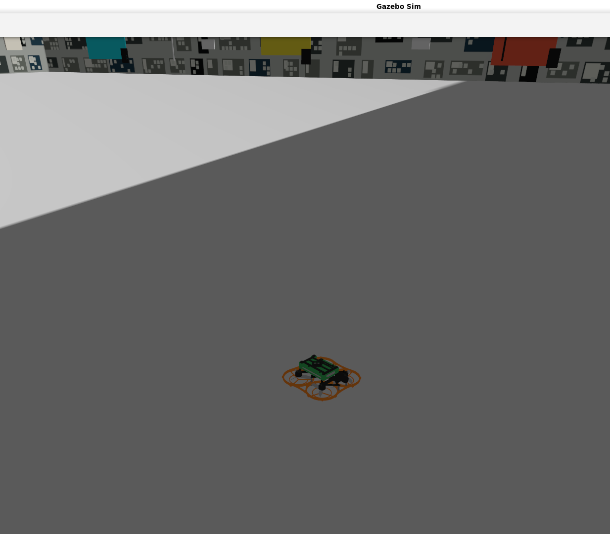
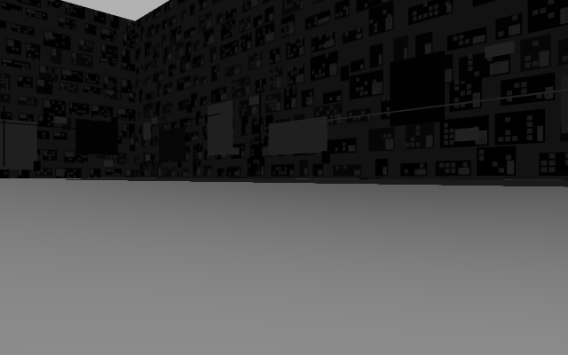

# SP27 视觉导航无人机仿真（WSL2 + PX4 + Gazebo Harmonic + ORB-SLAM3）

> 把同济 SuperPower 战队的 [sp_nav_drone_27](https://github.com/TongjiSuperPower/sp_nav_drone_27)（`dev_wwa_air` 分支）
> 视觉导航方案，在 **Windows + WSL2** 上从零搭起来、飞起来、并接入官方 RMUC2027 比赛场地的完整工程记录。

<p align="left">
  
  
</p>

---

## 这是什么

一套**可复现的部署脚本 + 一份踩坑全记录**。

- **不是**原仓库的 fork（原仓库是私有且庞大的 monorepo）
- **是**把它在 WSL2 上跑通所需的全部环境适配、构建脚本、验收工具，以及过程中定位的 12 个坑

适用对象：想在同一套栈（PX4 SITL + Gazebo + ROS 2 + MAVROS + ORB-SLAM3）上做视觉导航仿真验证的人，
尤其是在**内存受限的笔记本**上折腾的人。

---

## 实测结果

| 指标 | 值 |
|---|---|
| IMU / 双目图像 / ORB 里程计 / 视觉位姿 | 249 / 15.0 / 15.0 / 14.9 Hz |
| ORB 里程计时间戳延迟 | **50 ms**（修复前 752 ms） |
| 起飞高度 | **1.00 m** |
| 6 秒悬停漂移 | x −7.7 mm / y +8.2 mm / z +2.6 mm |
| 3D 位置误差（944 帧对比真值） | 均值 7.3 cm，中位 6.1 cm，**RMSE 8.3 cm**，p95 16.5 cm |
| 姿态误差 | 中位 0.55°，RMSE 0.60° |
| 自动验收 | **12/12 PASS** |

> 原论文报告悬停 RMSE 4.6–5.7 cm、旋转段 14.5 cm —— 本项目已达到同一量级。

---

## 环境

| 组件 | 版本 |
|---|---|
| 主机 | i9-13900HX / 15.7 GB RAM / RTX 4060 Laptop 8 GB / Windows 11 |
| WSL | 2.7.14 / Ubuntu 22.04（`memory=6656MB`，见下文「内存」） |
| ROS 2 | Humble |
| Gazebo | **Harmonic，gz-sim 8.15.0** |
| PX4 | **v1.16.2**（commit `54f0455`） |
| MAVROS | 2.16.0 |
| ros_gz | **1.0.25 源码编译**（apt 版是 Fortress，与本栈不兼容） |
| ORB-SLAM3 | 仓库内置 + **Pangolin v0.6** 源码构建 |

数据流：

```
Gazebo 双目/IMU/真值 ──ros_gz_bridge──> ROS 2
    └─ ORB-SLAM3 ──> vio_bridge（滤波/坐标/协方差）──> MAVROS ──MAVLink──> PX4 EKF2
                                        └─ offboard_controller ──setpoint──> PX4 ──> Gazebo
```

---

## 快速开始

```bash
# 1) 系统依赖（唯一需要 sudo 的一步）
sudo bash scripts/bootstrap_root.sh

# 2) 代码落地：仓库用 token 稀疏克隆；PX4 拉 v1.16.2 + 关键子模块
#    （详细命令见 docs/02-部署笔记.md）
bash scripts/patch_px4.sh     # 打补丁 + 导出 SP27 模型/世界/机型

# 3) 构建：Pangolin v0.6 → ORB_SLAM3 → colcon
bash scripts/build.sh

# 4) 启动（推荐先跑无 GUI 版，省约 1 GB 内存）
setsid nohup bash scripts/run_sim_headless.sh > /tmp/sim.log 2>&1 &
#    要看画面时用：setsid nohup bash scripts/run_sim.sh > /tmp/sim.log 2>&1 &

# 5) 起飞 / 悬停 / 降落
ros2 topic pub --once /offboard/command std_msgs/msg/String "{data: start_builtin}"
ros2 topic pub --once /offboard/command std_msgs/msg/String "{data: hold}"
ros2 topic pub --once /offboard/command std_msgs/msg/String "{data: land}"

# 6) 验收
bash scripts/verify_a.sh
```

---

## 目录结构

```
.
├── docs/
│   ├── 01-会话纪要.md                    ⭐ 全过程技术纪要（12 个坑的根因与解法）
│   ├── 02-部署笔记.md                   环境版本、改动清单、复现步骤
│   ├── 03-选型分析-是否脱离WSL.md        Isaac/UE/Unity/双系统 对比与推荐
│   └── 04-论文速读-NMI敏捷飞行.md        原论文方法与结论
├── scripts/
│   ├── bootstrap_root.sh               系统依赖（sudo）
│   ├── patch_px4.sh                    PX4 补丁 + 资源导出
│   ├── build.sh                        Pangolin → ORB_SLAM3 → colcon
│   ├── run_sim.sh                      启动（带 GUI）
│   ├── run_sim_headless.sh             启动（无 GUI，省内存）
│   ├── verify_a.sh                     12 项自动验收
│   └── certs/                          校园网 SSL 审计根证书（GitHub/apt 需要）
├── screenshots/
└── data/flight-logs/                   一次完整飞行的逐帧对比数据
    └── flight_20261107_024044_n5x7wu47/
        ├── comparison.csv              ORB vs 真值逐帧误差（做精度统计）
        ├── gazebo_truth.csv / imu.csv / tracking.csv / …
        └── summary.json
```

---

## 三个最容易踩的坑（详情见 [docs/01-会话纪要.md](docs/01-会话纪要.md)）

1. **ros_gz 必须用 Harmonic 版**
   apt 的 `ros-humble-ros-gz-bridge` 依赖 Gazebo **Fortress**（`ignition-transport11`），
   而 PX4 v1.16 用 **Harmonic**（`gz-transport13`）。症状极具迷惑性：话题能发现、进程不报错，
   但 **ROS 侧一条数据都收不到**，日志只刷 `Unknown message type`。
   → 源码编译 `ros_gz 1.0.25` 覆盖。

2. **`sync_queue_size` 必须调小（30 → 3）**
   30 帧 @15 Hz = 缓存 2 秒画面，ORB 输出因此固定落后仿真时钟 **0.75 s**，
   而 `vio_bridge` 的陈旧阈值是 **0.3 s** → **每帧被静默丢弃**（几乎无警告），
   表现为"没有视觉位姿 → PX4 不解锁（`Arming denied: Resolve system health failures first`）"。

3. **两个环境变量不能漏**
   `GIT_SUBMODULES_ARE_EVIL=1`（跳过 PX4 子模块联网检查）与
   `GEOGRAPHICLIB_DATA=$HOME/.local/share/GeographicLib`（MAVROS 需要 geoid 数据集）。

---

## 内存：本项目的真正瓶颈

WSL **会把分配的内存配额全部吃满**（page cache），剩下的才归 Windows。主机只有 15.7 GB：

| WSL 配额 | Windows 可用物理 | 结果 |
|---|---|---|
| 12 GB | 0.16 GB | 必卡死 |
| 8 GB | 0.89 GB | 卡死 |
| 6 GB | 0.44 GB | 卡死 |
| 5 GB | 1.02 GB | 仿真 OOM（`/clock` 都起不来） |
| **6656MB（推荐）** | ~1.0–1.4 GB | 可跑 |

**进一步缓解**：用 `run_sim_headless.sh`（无 GUI）→ WSL 只用 2.4 GB，Windows 回到 2.37 GB，
三路数据仍 15 Hz 满速。

```ini
# C:\Users\Justin\.wslconfig
[wsl2]
memory=6656MB      # 注意：不能用小数（6.5GB 会被拒），必须写 MB
processors=24
swap=3GB
[experimental]
autoMemoryReclaim=dropcache
sparseVhd=true
```

---

## 已知问题

1. **真实 RMUC2027 场地接入后精度下降**：世界能正常加载，但位置 RMSE 从 8.3 cm 涨到 **44.8 cm**，
   真值高度一度到 3.12 m，PX4 主动退出 OFFBOARD、位置估计发散。怀疑 ORB 在大场地丢跟踪/尺度漂移，
   **尚未定位完成**（排查方向见 [docs/01-会话纪要.md](docs/01-会话纪要.md) 第五部分）。
2. **固定航线未完整验证**：目前只做到起飞 → 悬停 → 降落；内置航线会因位置误差超过
   `turn_position_limit_m: 0.25` 而反复暂停。
3. **实机未涉及**：`flight.yaml` 的 `hardware` 段保持空值。

---

## 关于原仓库与第三方资产

- 本项目**不包含**原仓库代码，也不包含 `RMUC2027/meshes/model.dae`（96 MB）与 `RMUC2027_4.dae`（46.5 MB）
  —— 这两个文件在原作者仓库中被 `.gitignore` 显式排除，且属于 RoboMaster 赛事场地资产，**不随本仓库分发**。
  需要时向战队负责人索取，或参见 [docs/01-会话纪要.md](docs/01-会话纪要.md) 第六部分的公开替代方案。
- 许可证与第三方声明见 [NOTICE.md](NOTICE.md)。

---

## 相关链接

- 原项目：<https://github.com/TongjiSuperPower/sp_nav_drone_27>（私有）
- 论文：[Learning vision-based agile flight via differentiable physics](https://doi.org/10.1038/s42256-025-01048-0)，*Nature Machine Intelligence* 7, 954–966 (2025)
- 官方 2027 场地资源（社区开源帖）：<https://bbs.robomaster.com/article/1971528>
- 开源 2027 仿真项目：<https://github.com/RM-Arena/Arena-1>
